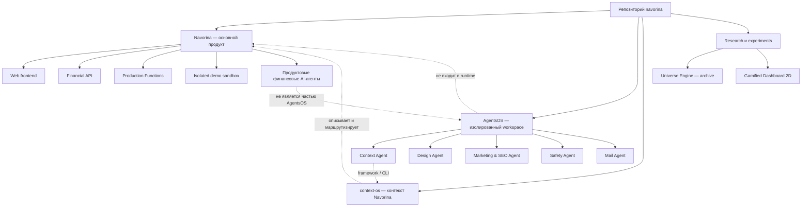

# Карта проектов Navorina

**Актуально на:** 2026-08-15

**Назначение:** отделить самостоятельные проекты от модулей Navorina, deploy-контуров,
служебных систем и архивных экспериментов.

## Короткий ответ

В репозитории находится **один основной продукт — Navorina** и **пять
переиспользуемых проектов AgentsOS** с независимыми зависимостями и проверками.

| Уровень учёта | Итого | Что входит |
|---|---:|---|
| Пользовательские продукты | 1 | Navorina |
| Самостоятельные engineering/release units | 6 | Navorina + 5 агентов AgentsOS |
| Активные служебные системы | 1 | заполненный `context-os/` для Navorina |
| Tracked research/experiments | 2 | Universe Engine archive + gamified dashboard |

`Nucleus`, `Assistant`, `Payments`, `Invoicing` и другие разделы ниже — это
**модули Navorina**, а не отдельные проекты. `frontend`, `server`, `functions` и
`functions-demo` — **deploy/runtime-контуры** одного продукта. `AgentsOS` —
workspace-зонтик, но каждый агент внутри него сохраняет собственную границу
версий, зависимостей, тестов и возможного релиза.

## Общая карта



## 1. Navorina — основной продукт

**Что это:** Crypto / Fin Hub для freelancers и небольших команд: финансовый
workspace, invoicing, receive/send, учёт, month close и AI-помощник.

**Продуктовая модель:** один продукт с несколькими пользовательскими областями и
двумя основными оболочками — Main Dashboard и Nucleus. Деньги и операции должны
проходить через общие capability/use-case contracts; оболочки не должны иметь
две независимые реализации одного действия.

**Корень:** репозиторий целиком; основной клиентский исходник — `Navorina/`.

### Продуктовые модули Navorina

| Модуль | Назначение | Основные точки входа |
|---|---|---|
| Marketing и account | Лендинг, auth, signup, подписка, настройки, legal/help | `Navorina/index.html`, `auth.html`, `signup.html`, `settings.html`, `subscribe.html` |
| Main Dashboard | Баланс, история и быстрые Deposit / Send / Swap / Buy / Invoice | `Navorina/dashboard.html` |
| Nucleus / Financial Mirror | Финансовый workspace, ledger, snapshots и доменная навигация | `Navorina/nucleus.html`, `Navorina/src/utils/financial-mirror.ts` |
| Payments | Receive, Send, crypto collections, treasury и payout flows | `Navorina/payments.html`, `nucleus-*-payments*.ts`, `nucleus-*-treasury*.ts` |
| Invoicing | Quotes, invoices, payment links, partial pay, crypto accept и reminders | `Navorina/invoicing.html`, `invoice-pay.html`, `crypto-checkout.html` |
| Accounting | Импорт банковских файлов, journal, export, Xero и month close pack | `Navorina/accounting.html`, `nucleus-accounting-*.ts` |
| Insights | Weekly Briefing, alerts, AI summaries и Trade Journal | `Navorina/insights.html`, `nucleus-trade-journal-*.ts` |
| Assistant | Чат, voice/sphere и финансовый intent routing | `Navorina/assistant.html`, `Navorina/src/core/chat.ts`, `Navorina/src/components/` |
| Tools | Invoice/quote/proposal/document/QR generators и calculators | `Navorina/*-generator.html`, `Navorina/calculator/` |
| Settings и delivery | Tier, security, email, push, crypto compliance и integration setup | `Navorina/settings.html`, `*-setup.html` |

Это модульная декомпозиция продукта. Она **не означает десять отдельных
репозиториев, компаний или release trains**.

### Runtime и deploy-контуры Navorina

| Контур | Путь | Роль | Самостоятельный продукт? |
|---|---|---|---|
| Web frontend | `Navorina/` | HTML/CSS/TS, локали и assets; production build | Нет |
| Financial API | `server/` | Authenticated API, FM, money rails, billing, integrations и cron | Нет |
| Production Functions | `functions/` | Firebase Functions proxy/entry для production | Нет |
| Product AI agents | `server/agents/` | Финансовые summaries, verdicts, explanations и reconciliation | Нет; доменный слой Navorina |
| Browser E2E | `e2e/` | Playwright journeys и live/emulator gates | Нет; verification layer |

### Главные внешние зависимости

| Направление | Сервисы / механизм | Текущая граница |
|---|---|---|
| Identity и product data | Firebase, Firestore | Принадлежат runtime Navorina |
| Durable server data | Supabase/Postgres + локальные stores/emulators | Не отдельный продукт |
| Billing | Stripe | Live cutover отделён от наличия кода/emulator |
| Delivery | Resend, Web Push | Отдельные readiness gates |
| Accounting | Xero | Интеграция Navorina |
| Money rails | direct-chain Base, crypto providers, fiat providers, Stripe Connect | Fail closed до соответствующего controlled/live pilot |

## 2. AgentsOS — workspace переиспользуемых агентов

**Что это:** организационный workspace внутри Navorina. Он не включён в корневой
npm workspace и не является частью product runtime. У каждого агента свои
dependencies, тесты, версии и release boundary.

**Корень:** `agents-os/`

**Общая проверка:** `npm run agents-os:verify`

**Архитектурная граница:** `docs/architecture/AGENTS_OS_WORKSPACE.md`

| Проект | Путь | Что делает | Тип |
|---|---|---|---|
| Context Agent | `agents-os/agents/context-agent/` | Framework и CLI для context cores, routing, validation, eval и drift checks | Node.js CLI/framework |
| Design Agent | `agents-os/agents/design-agent/` | UI/UX specification, critique, design-system knowledge и verification workflow | Skill + Python tooling/evals |
| Marketing & SEO Agent | `agents-os/agents/marketing-agent/` | Positioning, SEO/content/conversion audits и growth plans | Skill + Python auditor |
| Safety Agent | `agents-os/agents/safety-agent/` | Crypto lifecycle posture, PQC, threat models, scanning и policy gates | TypeScript CLI |
| Mail Agent | `agents-os/agents/mail-agent/` | Temporary inboxes, OTP/magic-link QA, MCP/REST и communication workflows | Independently deployable Cloudflare service |

### Жёсткие границы AgentsOS

- reusable agents не импортируют продуктовый код Navorina;
- финансовое поведение Navorina остаётся в `server/agents/` и domain services;
- корневой релиз Navorina не означает релиз любого агента;
- `agents-os/.github/workflows/` — migration references; исполняются только
  workflows из корневого `.github/workflows/`;
- Mail Agent может иметь собственный runtime, домены и клиентов, поэтому его
  миграция домена ведётся отдельно от Navorina.

## 3. Context OS Navorina — служебная система, не новый продукт

**Путь:** `context-os/`

Это заполненный экземпляр Context OS именно для этого репозитория: router,
business/product/technical/operational cores, узкие subcores, audit и eval.
Framework и CLI находятся отдельно в `agents-os/agents/context-agent/`.

```text
Context Agent framework/CLI
        ↓ создаёт, проверяет и обслуживает
context-os/ instance Navorina
        ↓ маршрутизирует вопросы к
business / product / technical / operational cores
```

Поэтому `context-os/` учитывается как активная служебная система, но не как
седьмой релизуемый продукт.

## 4. Research, prototypes и experiments

| Объект | Канонический путь | Статус | Пояснение |
|---|---|---|---|
| Universe Engine / Project Universe Research | `archive/research/project-universe-research/` | Архивный research prototype | Проверял nested living systems и AI Context Snapshot; не production runtime |
| Gamified Dashboard 2D | `Navorina/experiments/gamified-dashboard-2d/` | Experimental | Альтернативный UI-концепт вне основного PRD scope |

Локальные каталоги `project-universe-research/` и `prototypes/`, если они есть в
рабочем checkout, не являются каноническими tracked-проектами. Каноническая
версия Universe research уже перенесена в `archive/research/`.

## 5. Что не считать отдельными проектами

| Категория | Примеры | Почему не проект |
|---|---|---|
| Generated output | `build/`, `build-demo/`, `Navorina/dist-ts/`, `functions*/dist/` | Результат сборки исходного проекта |
| Runtime/local data | `server/.data/`, `test-results/`, `outputs/`, `tmp/` | Локальное состояние, отчёты или временные файлы |
| Documentation systems | `docs/`, `context-os/graph/`, `context-os/eval/` | Описывают или проверяют проекты |
| Test layers | `tests/`, `e2e/`, `Navorina/scripts/*.test.mjs` | Проверяют runtime, но не поставляются как продукт |
| Integration setup pages | `stripe-setup.html`, `xero-setup.html`, другие `*-setup.html` | Экраны и runbooks одного продукта |
| Product domains | Nucleus, Assistant, Payments, Invoicing, Accounting, Insights | Модули Navorina с общей product/release boundary |

## 6. Карта каталогов верхнего уровня

| Путь | Владелец / назначение |
|---|---|
| `Navorina/` | Клиент основного продукта |
| `server/` | API и доменная логика основного продукта |
| `functions/` | Production Firebase Functions |
| `functions-demo/` | Изолированные demo Firebase Functions |
| `agents-os/` | Пять reusable agent projects |
| `context-os/` | Контекстная модель этого репозитория |
| `docs/` | Product, architecture, design, setup, security и planning docs |
| `scripts/` | Root build/smoke/verify/deploy orchestration |
| `e2e/`, `tests/` | Browser и integration verification |
| `archive/` | История, snapshots и research; не current source of truth |
| `Navorina/experiments/` | Необязательные product experiments |

## 7. Правило добавления нового проекта

Новый каталог считается самостоятельным проектом, только если у него есть
большинство следующих признаков:

1. отдельная цель и аудитория;
2. собственный manifest или явный executable contract;
3. независимые dependencies и verification commands;
4. собственная release/deploy boundary;
5. явно описанный владелец и границы импорта;
6. он не является generated output, тестовой фикстурой или модулем Navorina.

Если этих признаков нет, новый код следует классифицировать как модуль Navorina,
часть существующего агента, эксперимент или служебный слой — без создания ещё
одного псевдопроекта.

## Источники истины

- `context-os/cores/product-core.md`
- `context-os/cores/business-core.md`
- `docs/planning/CURRENT_PRODUCT_HANDOFF.md`
- `docs/planning/roadmap/2026-CURRENT-YEAR-PLAN.md`
- `docs/architecture/OVERVIEW.md`
- `docs/architecture/AGENTS_OS_WORKSPACE.md`
- `agents-os/AGENTS.md`
- `package.json` и вложенные manifests
- tracked file inventory (`git ls-files`)
